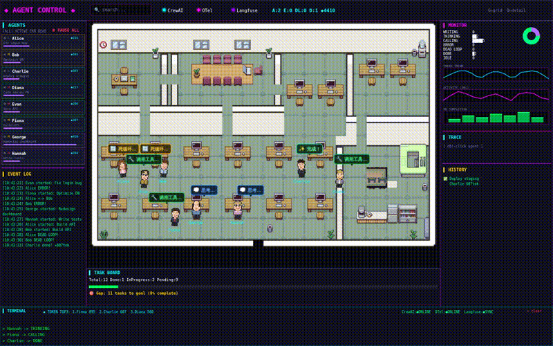
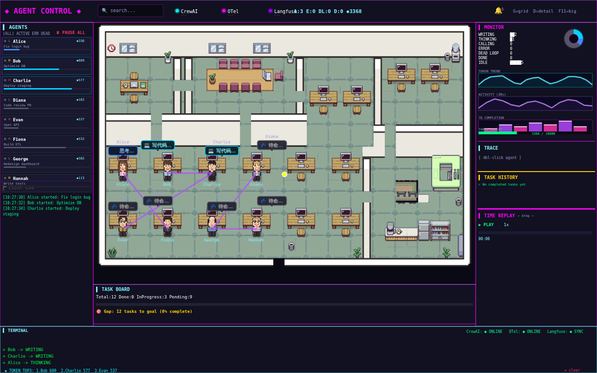
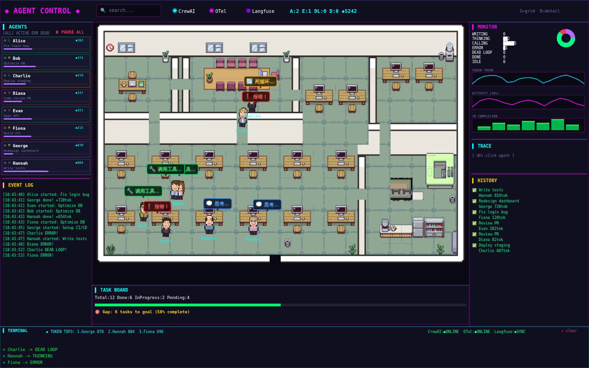
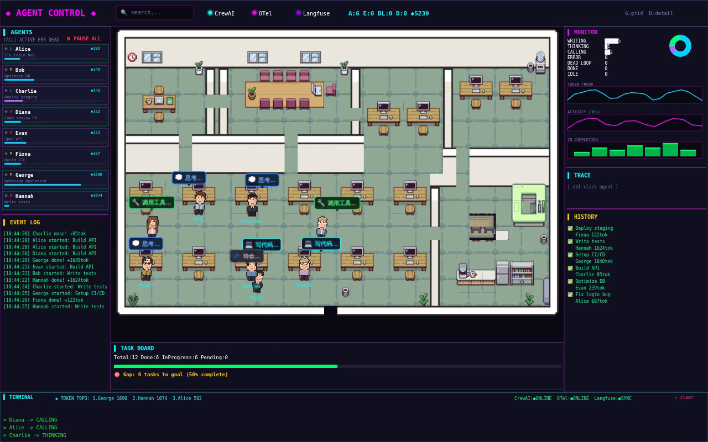

# 🎮 Agent Control Room

> Put your AI agent team in a virtual office. Monitor every agent's status like a mission control dashboard.

[English](README.md) | [中文](README.zh-CN.md)

  

---

## ✨ Highlights

- 🗺️ **Spatial Avatar Visualization** — Each agent has its own workstation, not just a boring list
- 🎭 **7 Live States with Animations** — Writing, thinking, calling tools, error, dead loop, success — each with its own emoji animation
- 💬 **State-Aware Group Chat** — Agents chat naturally when near each other, content adapts to current state and task type (writing→"函数快写完了", error→"帮我看看bug", success→"搞定了！")
- 🏛️ **Meeting Room Full Flow** — Initiator walks to meeting → invites others → 3+ gather shows "💬 会议中" → 15s later auto-disperse. Discussion bubbles rotate by task type.
- 🔔 **Alert Bell Panel** — Red flashing bell + count badge for errors/dead loops. Click to expand alert list, clear individual or all.
- 🔗 **Dynamic Task Dependencies** — Purple dependency lines auto-generated by task type. Completed lines turn gray.
- 🔌 **Hot-plug Agents** — New agents appear on the map automatically when they start, disappear when they stop.
- 📡 **WebSocket Real-time Push** — State changes sync in milliseconds
- 🎨 **Cyberpunk Control Room Style** — Neon glow + dark background, maximum tech vibe
- 📊 **Full-stack Monitoring** — Token usage, task progress, trace paths, event logs, time replay, token budget bar — all on one screen
- 📱 **Responsive + Mobile Drawer** — F11 big screen mode, mobile slide-out drawer panels
- ⚙️ **YAML Config Hot Reload** — Adapter config changes take effect without restart

---

## 🖼️ Preview



### Main Interface



### States in Action



### Agents Moving



---

## 🎯 Core Features

### State Machine (7 states)
| State | Icon | Visual |
|-------|------|--------|
| idle | 💤 | Idle, gray bubble |
| writing | 💻 | Writing code, white bubble |
| thinking | 💭 | Thinking, purple bubble |
| calling_tool | 🔧 | Calling tools, green bubble + walk to coffee room |
| error | ❗ | Error, red bubble + head-in-hands + walk to meeting room |
| dead_loop | 🔄 | Dead loop, yellow bubble + dizzy spin |
| success | ✨ | Success, green bubble + happy celebration |

### Multi-agent Collaboration
- Agents talk to each other ("Can you help me check this API?")
- Multi-agent meeting scenes (discussion in the meeting room)
- Task dependency flow (A finishes → B starts)

### Monitoring Panel
- 📊 State distribution pie chart
- 📈 Token consumption trend line
- 📈 Real-time activity curve
- 📊 7-day task completion bar chart
- 💎 Token usage ranking
- 🔌 Adapter status (CrewAI / OTel / Langfuse)

---

## 🏗️ Architecture

```
┌─────────────────────────────────────────┐
│     Agent Control Room Frontend (PixiJS) │
└───────────────┬─────────────────────────┘
                │ WebSocket
        ┌───────▼───────┐
        │   Registry    │
        │   Heartbeat   │
        │   Desk Assign │
        └───────┬───────┘
                │
    ┌───────────┼───────────┐
    │           │           │
┌───▼───┐  ┌───▼───┐  ┌───▼───┐
│CrewAI │  │  OTel  │  │Langfuse│
│Adapter│  │Adapter│  │Adapter │
└───────┘  └───────┘  └───────┘
```

### Hot-plug Protocol
```json
// Register
{ "type": "register", "agent_id": "alice", "name": "Alice" }

// State update
{ "type": "state", "agent_id": "alice", "state": "writing", "progress": 0.45, "tokens": 328 }

// Heartbeat
{ "type": "heartbeat", "agent_id": "alice" }

// Deregister
{ "type": "deregister", "agent_id": "alice" }
```

---

## 🚀 Quick Start

```bash
# Clone
git clone https://github.com/AllenD87/agent-control-room.git
cd agent-control-room

# Install dependencies
npm install

# Start WebSocket server
node server/index.js

# Start mock agents
node server/simulate.js

# Start frontend
npm run dev
```

Open `http://localhost:5174` in your browser.

---

## 🧩 Connect Your Agent

### Python SDK (WIP)

```python
from agent_control_room import Agent

alice = Agent(agent_id="alice", name="Alice")
alice.state = "writing"
alice.current_task = "Fix login bug"
alice.progress = 0.45
```

### Manual Connection

```bash
# Send WebSocket message to register
wscat -c ws://localhost:5175
> {"type": "register", "agent_id": "my_agent", "name": "My Agent"}
```

---

## 🛠️ Tech Stack

- **Frontend:** PixiJS (pixel rendering) + Vite + Vanilla JS
- **Backend:** Node.js + WebSocket (ws)
- **Style:** Cyberpunk neon / Glassmorphism / Matrix terminal (switchable)
- **Assets:** Munder Difflin open-source pixel office

---

## 📋 Roadmap

- [x] M1: Pixel office + 7-state machine + product UI
- [x] M2: WebSocket backend + registry + 3 adapters
- [ ] M3: Python SDK + CLI tool + Adapter template
- [ ] M4: User avatar interaction (walk to agent to pause/approve)
- [ ] M5: History replay + big screen mode
- [ ] M6: Real CrewAI / OTel / Langfuse data integration

---

## 📄 License

MIT

---

**Star if you like it ⭐**
